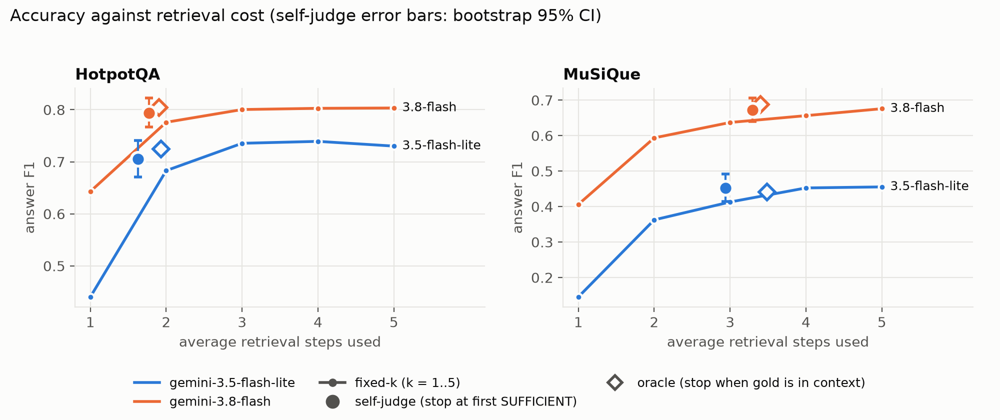
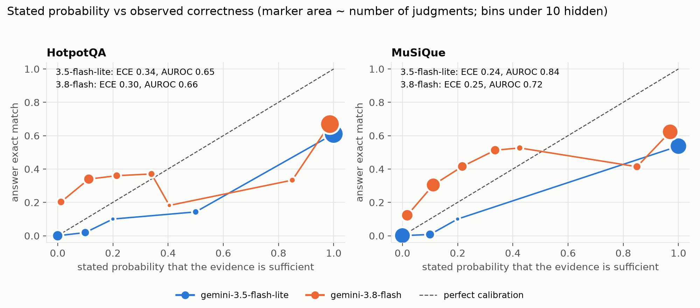

# When Is Enough Evidence Enough? Sufficiency Judgments and Stopping Rules in Multi-Step Retrieval Agents

**Garvit Kaushik** · October 2026 · Technical report, not peer reviewed

Code, logs and all numbers: <https://github.com/garvitkaushik-123/evidence-sufficiency-agents>

## Abstract

A retrieval agent that searches in several steps must decide when it has seen enough. We let two Gemini models retrieve for five steps over a BM25 index and, after every step, state whether the evidence suffices, how likely that is, and their current answer. Logging every step lets us replay any stopping rule offline from one run per model. On 500 HotpotQA and 500 MuSiQue questions we ask how often "enough" is true, whether the judgement predicts a correct answer, and which rule gives the best accuracy for the retrieval spent. Stopping at the first "sufficient" verdict uses 34 to 67% fewer steps than always taking five, at an answer-F1 cost that is not significant in three of four model and dataset pairs and about 0.025 in the fourth. Model choice moves F1 by 0.07 to 0.26, far more than any rule. Against "all gold paragraphs retrieved" the verdict is right 65 to 93% of the time, but a read of 50 apparent premature stops found about 7 in 10 already answerable from the retrieved text, so gold coverage understates it. A dense retriever (small model only) gives the same picture with larger savings. Stated probabilities sit near 0 and 1 and are poorly calibrated; much of their apparent power to predict correctness comes from answers that abstain, and on answered steps the small model's probability is no better than chance.

## 1. Introduction

Agents that search before answering spend a cost with every retrieval step: time, tokens and money. Stopping too early risks a wrong answer; stopping too late wastes retrieval. The agent's own sense of "I have enough" is the obvious signal, but it is rarely tested against ground truth. We test it.

Three questions:

- **RQ1.** When the agent says the evidence suffices, how often is that true?
- **RQ2.** Does the judgement, or the stated probability, predict whether the final answer is correct, and is it calibrated?
- **RQ3.** Which stopping rule (fixed steps, first sufficient verdict, probability threshold, oracle) gives the best accuracy per retrieval step?

Multi-hop QA datasets mark which paragraphs are needed, so "sufficient" has an objective reading without human labelling: all gold supporting paragraphs are in the agent's context. We also use a second, looser label: the gold answer text appears in the retrieved evidence.

## 2. Related work

Several methods decide during generation when more evidence is needed. IRCoT interleaves retrieval with chain-of-thought sentences and ends when the reasoning produces an answer or a step budget runs out (Trivedi et al., 2023). FLARE retrieves when the next sentence contains low-probability tokens (Jiang et al., 2023), and Self-RAG trains a model to emit reflection tokens that decide when to retrieve and critique what it retrieved (Asai et al., 2023). Adaptive-RAG instead routes each question to no, single-step or iterative retrieval with a trained complexity classifier (Jeong et al., 2024). In these systems the stopping decision is implicit in answering or learned jointly with the model; none of them, in the papers we read, isolates it and compares simple rules on the same logged trajectories.

The closest work asks whether the retrieved context is sufficient. Joren et al. (2025) define sufficient context as context from which a plausible answer can be derived, label it with an LLM autorater, and show that models often answer instead of abstaining when context is insufficient, yet are also correct on a sizeable share of such questions. They combine the label with self-reported confidence for selective answering, and note in their limitations that the autorater could be used to decide whether to retrieve more, which they do not try. We study that setting. The answering model judges its own evidence after every step of a five-step loop; we score the verdicts against two objective labels and compare stopping rules by accuracy against retrieval steps. Because the verdict comes from the answering model rather than a separate autorater, the results also bear on how far self-assessment can be trusted, a concern studied for web agents by AgentRewardBench (Lù et al., 2025).

## 3. Setup

**Data.** HotpotQA distractor dev (Yang et al., 2018) and MuSiQue-Ans dev (Trivedi et al., 2022); 500 questions each, sampled with a fixed seed (IDs in `data/ids/`). HotpotQA was taken from the HuggingFace mirror and converted to the original format. Each dataset's corpus pools and deduplicates the paragraphs of its 500 sampled questions: 4,945 paragraphs for HotpotQA and 7,017 for MuSiQue.

**Agent loop.** Up to T = 5 steps. Step 1 searches with the question. Later steps search with a query the model writes from the question and the evidence so far. BM25 (Robertson and Zaragoza, 2009) returns k = 3 paragraphs per step, excluding paragraphs already retrieved, so the context grows to 15 distinct paragraphs. After every step the model, which sees only the question and the evidence, outputs a verdict (SUFFICIENT or INSUFFICIENT), a probability that the evidence suffices, and its current answer. The agent always runs all five steps and everything is logged.

**Dense retriever (robustness check).** For the small model only, the loop was rerun with `gemini-embedding-2` (768 dimensions, cosine, query-task and document-task embeddings) in place of BM25; nothing else changed, and the same rules and metrics were applied.

**Models.** `gemini-3.5-flash-lite` (small) and `gemini-3.8-flash` (strong), run with temperature 0, the small model on 11 October 2026 and the strong model between 11 and 12 October 2026 (India Standard Time, from the log file timestamps). Both are thinking models, so reruns need not be bit-identical; the committed logs are the record.

**Stopping rules, computed offline from the logs.** Fixed-k (k = 1, 3, 5); self-judge (stop at the first SUFFICIENT verdict, else step 5); threshold (first step with probability at least tau, tau from 0.5 to 0.95); oracle (first step where all gold paragraphs are in context, else step 5).

**Metrics.** Answer exact match and token F1 after lower-casing and removing punctuation and articles, taking the best match over aliases. RQ1: precision, recall and F1 of the verdict against each label, over all (question, step) pairs; a premature stop is SUFFICIENT with the label false, over-retrieval is INSUFFICIENT with the label true. RQ2: AUROC and expected calibration error (10 bins) of the stated probability against answer exact match. RQ3: mean steps and F1 with 95% bootstrap confidence intervals over questions (1,000 resamples), and paired bootstrap tests (2,000 resamples) for differences between rules and between models on the same questions.

**Reproducibility.** All logs (one JSON line per question with every step) are in the repository, so every number below can be recomputed without an API key (`make setup data eval report`). The sampled question IDs are committed.

## 4. Results

### 4.1 RQ3: stopping rules

| | HotpotQA small | HotpotQA strong | MuSiQue small | MuSiQue strong |
|---|---|---|---|---|
| fixed-1: F1 | 0.440 | 0.643 | 0.145 | 0.406 |
| fixed-3: F1 | 0.736 | 0.800 | 0.413 | 0.637 |
| fixed-5: F1 | 0.730 | 0.803 | 0.455 | 0.676 |
| self-judge: steps, F1 | 1.63, 0.705 | 1.77, 0.793 | 2.94, 0.452 | 3.29, 0.673 |
| oracle: steps, F1 | 1.93, 0.725 | 1.91, 0.805 | 3.48, 0.440 | 3.40, 0.688 |

*Table 1. Answer F1 by stopping rule, 500 questions per dataset (95% intervals in `results/rule_tables.md`).*

- **Self-judging saves most of the retrieval at little cost in accuracy.** It uses 1.6 to 1.8 of five steps on HotpotQA (65 to 67% fewer) and 2.9 to 3.3 on MuSiQue (34 to 41% fewer). Compared with always taking five steps, the F1 difference is -0.003 on MuSiQue for both models (intervals [-0.028, +0.022] and [-0.015, +0.008]) and -0.010 for the strong model on HotpotQA ([-0.023, +0.002]), none significant. For the small model on HotpotQA it is -0.025 ([-0.049, -0.001]), a small but significant loss.
- **On MuSiQue more steps matter.** Fixed-3 is worse than fixed-5 by about 0.04 F1 for both models (significant), whereas on HotpotQA 3 and 5 steps do not differ. At roughly the same number of steps (0.06 fewer for the small model, 0.29 more for the strong one), self-judge beats fixed-3 on MuSiQue by 0.035 to 0.040 F1 (significant): it spends steps where they are needed.
- **The oracle is only slightly better than self-judge.** The gain is at most 0.02 F1 (0.011 to 0.019 on HotpotQA and 0.016 for the strong model on MuSiQue, significant; -0.012 for the small model on MuSiQue, not significant). Knowing exactly when the gold evidence is complete is worth little here.
- **Thresholds add little.** For tau = 0.7 and 0.8 the result matches self-judge to within 0.001 F1 in all four cases. tau = 0.5 differs only for the small model on HotpotQA (F1 -0.04, 1.55 steps). tau = 0.9 and 0.95 let the strong model take up to 0.2 more steps for at most +0.007 F1 (see Section 4.3).
- **The model matters far more than the rule.** The strong model beats the small one by 0.07 to 0.26 F1 under every rule on both datasets, all significant.

### 4.2 RQ1: how often is "enough" true?

| | Label | precision | recall | premature stops | over-retrieval |
|---|---|---|---|---|---|
| HotpotQA small | gold coverage | 0.900 | 0.945 | 211 | 110 |
| | answer in context | 0.958 | 0.912 | 83 | 183 |
| HotpotQA strong | gold coverage | 0.929 | 0.952 | 147 | 97 |
| | answer in context | 0.980 | 0.912 | 38 | 183 |
| MuSiQue small | gold coverage | 0.646 | 0.771 | 452 | 245 |
| | answer in context | 0.863 | 0.685 | 175 | 507 |
| MuSiQue strong | gold coverage | 0.783 | 0.790 | 245 | 236 |
| | answer in context | 0.946 | 0.650 | 61 | 577 |

*Table 2. SUFFICIENT verdicts against two labels, over 2,500 (question, step) pairs per cell (fewer for the second label, which skips yes/no questions on HotpotQA).*

Precision depends strongly on the label. Against gold coverage the verdict is right 90 to 93% of the time on HotpotQA and 65 to 78% on MuSiQue; against answer-in-context it is right 96 to 98% and 86 to 95%. Premature stops are concentrated at step 1: of the questions where the small model said SUFFICIENT at step 1, 126 of 301 (HotpotQA) and 90 of 122 (MuSiQue) still lacked a gold paragraph; for the strong model, 72 of 246 and 33 of 64. The strong model makes fewer premature stops than the small one. Over-retrieval grows under the looser label, so the models are cautious as well as sometimes hasty. On MuSiQue the gold paragraphs are not all retrieved within five steps for 177 (strong) to 189 (small) of 500 questions, against 21 to 25 on HotpotQA, a BM25 limit that caps what any rule can reach.

### 4.3 RQ2: does the judgement predict correctness?

| | AUROC, all steps | AUROC, answered steps | ECE | abstention-like answers |
|---|---|---|---|---|
| HotpotQA small | 0.654 | 0.513 | 0.340 | 352 of 2,500 |
| HotpotQA strong | 0.660 | 0.619 | 0.296 | 113 of 2,500 |
| MuSiQue small | 0.835 | 0.511 | 0.243 | 1,210 of 2,497 |
| MuSiQue strong | 0.717 | 0.632 | 0.253 | 385 of 2,500 |

*Table 3. Stated probability against answer exact match. "Answered steps" drops answers that say the evidence lacks the answer (for example "Not enough information"; a keyword match, so approximate).*

Over all steps the stated probability predicts correctness modestly (AUROC 0.65 to 0.84, ECE 0.24 to 0.34). Much of that signal is abstention: when a model writes an answer such as "Not enough information" it also states a low probability, and exact match counts that answer wrong by construction. Such answers are 48% of the small model's steps on MuSiQue and 14% on HotpotQA, against 15% and 5% for the strong model. On steps where the model commits to an answer, AUROC is 0.51 on both datasets for the small model, no better than chance, and 0.62 to 0.63 for the strong model. This also explains why the small model's all-steps AUROC on MuSiQue is higher than the strong model's (0.84 against 0.72, difference +0.12, 95% bootstrap interval 0.09 to 0.16): it abstains much more often. When a model states a probability of exactly 1, its answers are exactly right 61% (small) and 72% (strong) of the time on HotpotQA and 54% and 74% on MuSiQue. The probabilities also cluster at the ends: the small model says exactly 0 or 1 in 93 to 94% of judgements, the strong model in 61% (HotpotQA) and 25% (MuSiQue), with 91% and 75% within 0.1 of an extreme.

### 4.4 Robustness to the retriever (small model)

With the question as the query, all gold paragraphs are in the top 3 for 89% of HotpotQA and 30% of MuSiQue questions under dense retrieval, against 37% and 7% under BM25 (`results/retrieval_check.md`). Within the agent loop gold is in context at step 1 for 443 and 149 of 500 questions, against 183 and 36, and is never reached in five steps for 4 and 117, against 21 and 189.

| | HotpotQA BM25 | HotpotQA dense | MuSiQue BM25 | MuSiQue dense |
|---|---|---|---|---|
| fixed-1: F1 | 0.440 | 0.717 | 0.145 | 0.331 |
| fixed-3: F1 | 0.736 | 0.757 | 0.413 | 0.496 |
| fixed-5: F1 | 0.730 | 0.743 | 0.455 | 0.521 |
| self-judge: steps, F1 | 1.63, 0.705 | 1.24, 0.768 | 2.94, 0.452 | 2.39, 0.522 |
| oracle: steps, F1 | 1.93, 0.725 | 1.18, 0.748 | 3.48, 0.440 | 2.74, 0.514 |
| verdict precision vs gold coverage | 0.900 | 0.975 | 0.646 | 0.725 |
| verdict precision vs answer in context | 0.958 | 0.987 | 0.863 | 0.920 |
| AUROC all steps, answered steps | 0.654, 0.513 | 0.586, 0.514 | 0.835, 0.511 | 0.776, 0.506 |

*Table 4. Small model, BM25 against dense retriever, 500 questions per dataset.*

The conclusions hold. Dense retrieval raises F1 under every rule (paired differences on MuSiQue +0.066 to +0.186, all significant; on HotpotQA +0.277 at one step and +0.063 for self-judge, significant, but +0.013 at five steps and +0.023 for the oracle, not). Self-judge now saves more of the retrieval, 75% on HotpotQA and 52% on MuSiQue, and compared with five fixed steps its F1 difference is +0.025 on HotpotQA (95% interval 0.006 to 0.045, significant) and +0.000 on MuSiQue ([-0.028, +0.028]). The oracle still adds nothing: it is 0.020 worse than self-judge on HotpotQA (significant) and 0.008 worse on MuSiQue (not significant). The oracle stops when the gold paragraphs are complete, which is not the same as the answer having been found. The probability is again uninformative on answered steps (AUROC 0.51). Only the small model was rerun, so we cannot say whether the strong model's gains from self-judging also carry over.

## 5. Error analysis

We sampled 50 of the 188 premature stops of the strong model (25 per dataset, fixed seed) and tagged why the agent stopped (cases, tags and supporting quotes are in `results/error_analysis/`). **The tagging was done by an LLM, not a human, and a human check is still missing.** It was done in two passes by the same model. The second used a stricter written rule (every link in the chain must be stated in the shown text, each answerable tag carries its supporting sentence) and changed 3 of 50 tags; a third read of 12 cases with the tags hidden agreed on all 12. All three passes were done by the same model, so this measures the consistency of one annotator, not agreement between annotators. A string match does not prove support, so treat the counts as a first pass.

| cause | HotpotQA | MuSiQue |
|---|---|---|
| answerable from the retrieved evidence | 21 | 15 |
| parametric (answer from the model's own knowledge) | 2 | 4 |
| ambiguous question or gold label | 0 | 3 |
| partial answer | 2 | 0 |
| distractor taken as evidence | 0 | 2 |
| needed hop never retrieved | 0 | 1 |

In 36 of 50 cases the answer was already supported by the retrieved text; the missing gold paragraph was a bridge or descriptor page. An automatic check on all premature stops agrees: the gold answer text is already in the evidence in 76% of the strong model's premature stops on both datasets and in 60% (HotpotQA) and 50% (MuSiQue) of the small model's. So gold coverage is a conservative proxy for sufficiency, and the small model stops genuinely too early more often. Real failures are few and instructive: taking a career scoring record for a single-season record, picking the wrong person of the same name, and skipping the hop that links an author to the statement being asked about. Several exact-match misses are formatting only (for example "Poland" against "Polish state"), so F1 is the fairer metric.

## 6. Limitations

- Two Gemini models from one family and 500 questions per dataset. BM25 is the main retriever; a dense retriever was run for the small model only.
- The pooled corpus is much smaller than open-domain search, so retrieval is easier than in practice.
- Gold coverage is a proxy for sufficiency, and the answer-in-context label is lenient (a string match can be coincidental). The truth lies between them.
- The verdict is the answering model's own, produced with a fixed prompt; other prompts could change it.
- The error analysis is a single LLM tagger on 50 of 188 cases.
- Thinking models are not bit-reproducible, and the HotpotQA data comes from a mirror of the official release.

## 7. Conclusion and next steps

Letting a model decide when to stop retrieving worked well here: a third to two thirds of the retrieval saved at an accuracy cost that is mostly not distinguishable from zero, a choice of model that matters far more than the choice of rule, and the same pattern with a dense retriever. Its judgement is better than gold coverage suggests, but the stated probability is a coarse, poorly calibrated signal: once abstentions are set aside it is only weakly informative about correctness for the strong model and uninformative for the small one. A thesis could test open-domain corpora and the strong model with the dense retriever, add a separate sufficiency judge as in Joren et al. (2025) to compare with self-judgement, train or calibrate the stopping signal, and run the same loop with open-weights models.

## References

- Asai, A., Wu, Z., Wang, Y., Sil, A., and Hajishirzi, H. (2023). Self-RAG: Learning to retrieve, generate, and critique through self-reflection. arXiv:2310.11511.
- Jeong, S., Baek, J., Cho, S., Hwang, S. J., and Park, J. C. (2024). Adaptive-RAG: Learning to adapt retrieval-augmented large language models through question complexity. NAACL. arXiv:2403.14403.
- Jiang, Z., Xu, F. F., Gao, L., Sun, Z., Liu, Q., Dwivedi-Yu, J., Yang, Y., Callan, J., and Neubig, G. (2023). Active retrieval augmented generation. EMNLP. arXiv:2305.06983.
- Joren, H., Zhang, J., Ferng, C.-S., Juan, D.-C., Taly, A., and Rashtchian, C. (2025). Sufficient context: A new lens on retrieval augmented generation systems. ICLR. arXiv:2411.06037.
- Lù, X. H., Kazemnejad, A., Meade, N., Patel, A., Shin, D., Zambrano, A., Stańczak, K., Shaw, P., Pal, C. J., and Reddy, S. (2025). AgentRewardBench: Evaluating automatic evaluations of web agent trajectories. arXiv:2504.08942.
- Robertson, S. and Zaragoza, H. (2009). The probabilistic relevance framework: BM25 and beyond. Foundations and Trends in Information Retrieval.
- Trivedi, H., Balasubramanian, N., Khot, T., and Sabharwal, A. (2022). MuSiQue: Multihop questions via single-hop question composition. TACL. arXiv:2108.00573.
- Trivedi, H., Balasubramanian, N., Khot, T., and Sabharwal, A. (2023). Interleaving retrieval with chain-of-thought reasoning for knowledge-intensive multi-step questions. ACL. arXiv:2212.10509.
- Yang, Z., Qi, P., Zhang, S., Bengio, Y., Cohen, W. W., Salakhutdinov, R., and Manning, C. D. (2018). HotpotQA: A dataset for diverse, explainable multi-hop question answering. EMNLP. arXiv:1809.09600.
